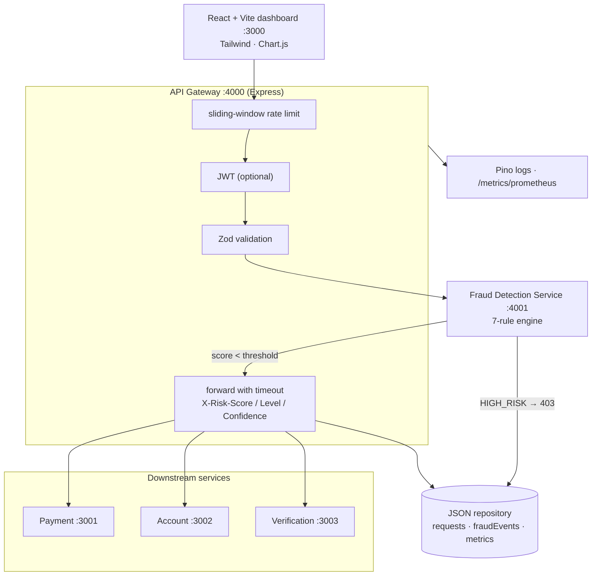
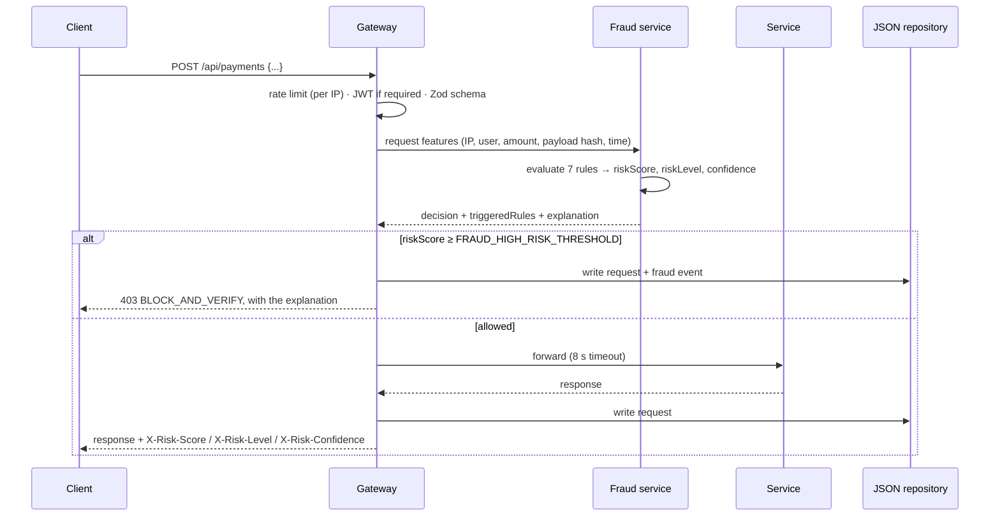

# API Gateway — Explainable Fraud Detection

**An API gateway that scores every request with a deterministic, seven-rule fraud engine before it reaches a service — and explains every decision it makes.**

[](package.json)
[](backend/gateway/server.js)
[](frontend/package.json)
[](backend/gateway/swagger.js)
[](docker-compose.yml)
[](backend/fraud-service/engine.js)

All API traffic is scored by a standalone fraud-detection service before it is
forwarded downstream. A request at or above the high-risk threshold is blocked
with a 403; everything else goes through with its risk score in the response
headers. Every decision carries the rules that fired, their severity and a
one-sentence explanation — no black box. A real-time SOC dashboard shows it all.

---

## Contents

| Section | |
|---|---|
| [What it does](#what-it-does) | The feature surface, by area |
| [Architecture](#architecture) | Gateway, fraud service, downstream services |
| [How a request is scored](#how-a-request-is-scored) | Limit, validate, score, block or forward |
| [Quick start](#quick-start) | Node or Docker |
| [The fraud engine](#the-fraud-engine) | Seven rules and what a decision contains |
| [Project status](#project-status) | What v2.0.0 changed, and the production path |
| [Design decisions](#design-decisions) | The tradeoffs, and why |
| [Reference](#reference) | API routes, ports, environment |
| [Repository layout](#repository-layout) | Where things live |
| [Team](#team) | Who built it |

---

## What it does

| Area | Capabilities |
|---|---|
| **Gateway** | Rate limiting, optional JWT auth, Zod validation, request forwarding with timeouts, `X-Risk-*` headers on every response |
| **Fraud engine** | Seven deterministic rules, a 0–100 risk score, a risk level, a confidence, a recommendation and a written explanation |
| **Services** | Payment, account and verification microservices behind the gateway |
| **Persistence** | JSON-file repository with atomic writes for requests, fraud events and metric snapshots |
| **Observability** | Pino structured logs, JSON and Prometheus metrics, request logs, a per-minute risk timeline, an endpoint heatmap |
| **Dashboard** | Service health, metric cards, traffic timeline, risk histogram, rule-trigger chart, live request stream, threat insights |
| **Demo** | Seven pre-built attack simulations from the dashboard |
| **Docs** | OpenAPI 3.0 with Swagger UI at `/api-docs` |

---

## Architecture



---

## How a request is scored



---

## Quick start

```bash
# Node — install, build the dashboard, start all five backend services
npm install
cd frontend && npm install && npm run build && cd ..
npm start                       # Payment → Account → Verification → Fraud → Gateway

# or Docker, one command
docker compose up --build
```

Dashboard at http://localhost:3000, Swagger UI at http://localhost:4000/api-docs.
Copy `.env.example` to `.env` to change thresholds, weights and auth.

---

## The fraud engine

Every decision includes `riskScore` (0–100), `riskLevel` (`NORMAL` /
`SUSPICIOUS` / `HIGH_RISK`), `confidence` (0–1), a `recommendation`
(`ALLOW_NORMAL` / `ALLOW_WITH_MONITORING` / `REQUIRE_ADDITIONAL_AUTH` /
`BLOCK_AND_VERIFY`), `triggeredRules[]` with per-rule severity, score and
reasoning, and a one-sentence `explanation`.

| Rule | What it detects |
|---|---|
| `RAPID_FIRE` | Too many requests from one IP in the sliding window |
| `PAYLOAD_ANOMALY` | A transaction amount that is a z-score outlier against the rolling mean |
| `TIME_BASED` | A high-value transaction outside 09:00–21:00 |
| `SEQUENTIAL_PATTERN` | An identical payload hash repeated within the window |
| `CREDENTIAL_STUFFING` | Many distinct user ids from the same IP |
| `BURST_TRANSFER` | Rapid payments from one user to the same recipient |
| `VELOCITY_SPIKE` | Sudden acceleration against an EMA baseline per IP |

Every rule can be enabled, disabled and weighted individually through
environment variables.

---

## Project status

**v2.0.0** ([CHANGELOG.md](CHANGELOG.md)) turned the original prototype into the
current shape:

| Change | Detail |
|---|---|
| Standalone fraud service | Moved out of the gateway onto its own port |
| Seven rules, up from four | Added credential stuffing, burst transfer and velocity spike; three-tier severity |
| Honest naming | Removed "AI-powered" / "ML" language — it is a rule-based, explainable engine |
| Shared backend modules | Central config, Pino logging, atomic JSON persistence, Zod validators, a rate limiter |
| Bug fixes | A divide-by-zero in the z-score, false-positive sequence matches on GET bodies, missing `Content-Length` and timeouts on forwarding, a deprecated socket API |

**Production path.** Persistence is a JSON-file repository in `./data/`; swap
`backend/shared/db.js` for PostgreSQL or SQLite behind the same interface. Rate
limiting is in memory; swap the store in `rateLimiter.js` for Redis to scale
horizontally. There is no automated test suite yet.

---

## Design decisions

**Rules, not a model.** Every score is deterministic and auditable: the same
request always gets the same answer, and the answer says why. That is the
property a fraud team needs before it trusts a block.

**Score before forwarding.** The gateway is the only path to the services, so a
high-risk request never reaches them.

**Recommendations, not just verdicts.** Between allow and block sit "allow with
monitoring" and "require additional auth", so a suspicious request can be
challenged instead of refused.

**Configuration is the policy.** Thresholds, rule weights, rate limits and auth
all come from environment variables with safe defaults, in one config module.

**Interfaces ready for scale.** The repository and the rate-limiter store are
narrow interfaces, so PostgreSQL and Redis are drop-in replacements.

---

## Reference

<details>
<summary><b>API routes</b></summary>

| Method | Path | Description |
|---|---|---|
| POST · GET | `/api/payments` · `/api/payments/:transactionId` | Create a payment · get one |
| POST · GET · PUT | `/api/accounts` · `/api/accounts/:accountId` | Create, get, update an account |
| POST | `/api/verify/identity` · `/api/verify/transaction` | Verify identity · verify a transaction |
| POST | `/api/auth/token` | Issue a JWT (when configured) |
| GET | `/health` | Gateway health |
| GET | `/metrics` · `/metrics/prometheus` | JSON snapshot · Prometheus text |
| GET | `/logs` · `/logs/timeline` · `/logs/endpoint-heatmap` · `/logs/fraud-events` | Request log, per-minute risk, per-endpoint counts, high-risk events |
| GET | `/api/fraud-patterns` | Rule-trigger frequencies |
| POST | `/api/clear-logs` · `/api/reset-metrics` | Clear logs · reset metrics and engine state |
| GET | `/api-docs` | Swagger UI |

</details>

| Service | Port |
|---|---|
| React dashboard | 3000 |
| Payment · Account · Verification | 3001 · 3002 · 3003 |
| API gateway | 4000 |
| Fraud detection | 4001 |

```env
NODE_ENV=development
JWT_SECRET=                    # empty = auth disabled
REQUIRE_AUTH=false
FRAUD_HIGH_RISK_THRESHOLD=70   # block at or above this score
FRAUD_RAPID_FIRE_COUNT=20      # requests in the window before RAPID_FIRE fires
RATE_LIMIT_MAX_REQUESTS=120    # per IP per minute
LOG_PRETTY=true                # false = JSON (production)
```

To require auth: set `JWT_SECRET` and `REQUIRE_AUTH=true`, get a token from
`POST /api/auth/token`, and send `Authorization: Bearer <token>`.

---

## Repository layout

```
.
├── backend/
│   ├── gateway/          API gateway and the OpenAPI 3.0 spec
│   ├── fraud-service/    the 7-rule engine and its HTTP service
│   ├── services/         payment, account and verification services
│   └── shared/           config, JSON repository, Pino logger, rate limiter, Zod validators
├── frontend/             React + Vite + Tailwind dashboard
├── Dockerfile.*          gateway, fraud, services and frontend images
├── docker-compose.yml
└── start.js              Node process orchestrator
```

---

## Team

| Member | Focus |
|---|---|
| **Guru R Bharadwaj** | Gateway, fraud engine, services and dashboard |
